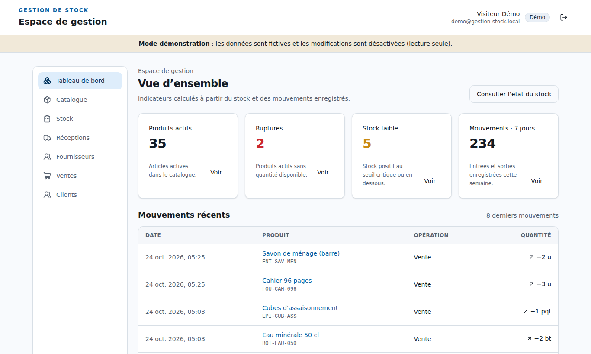
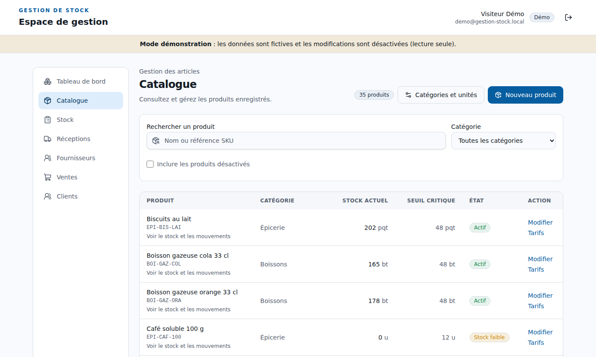
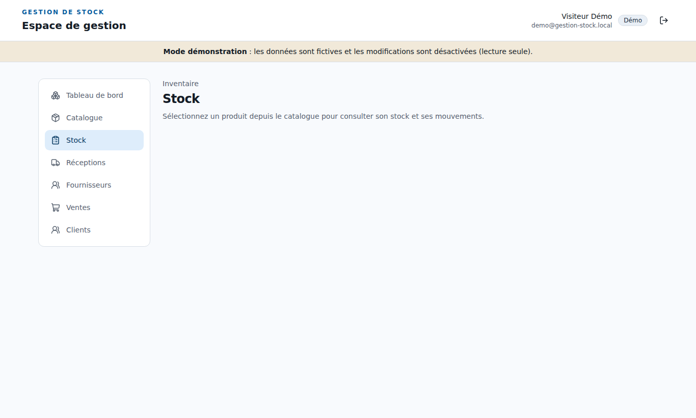
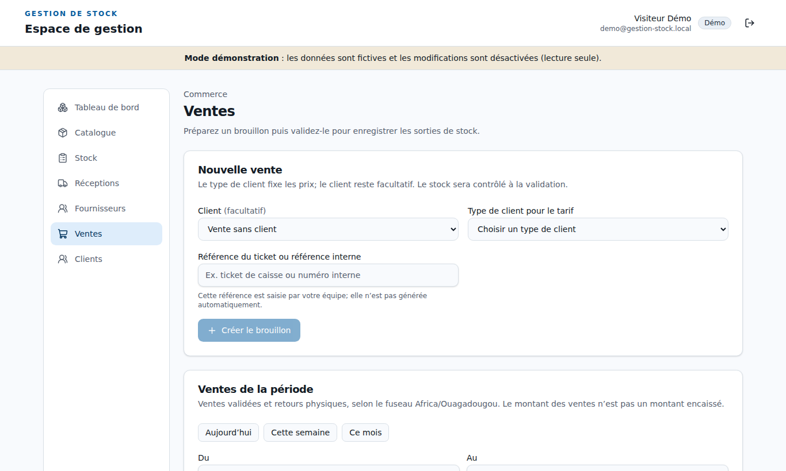
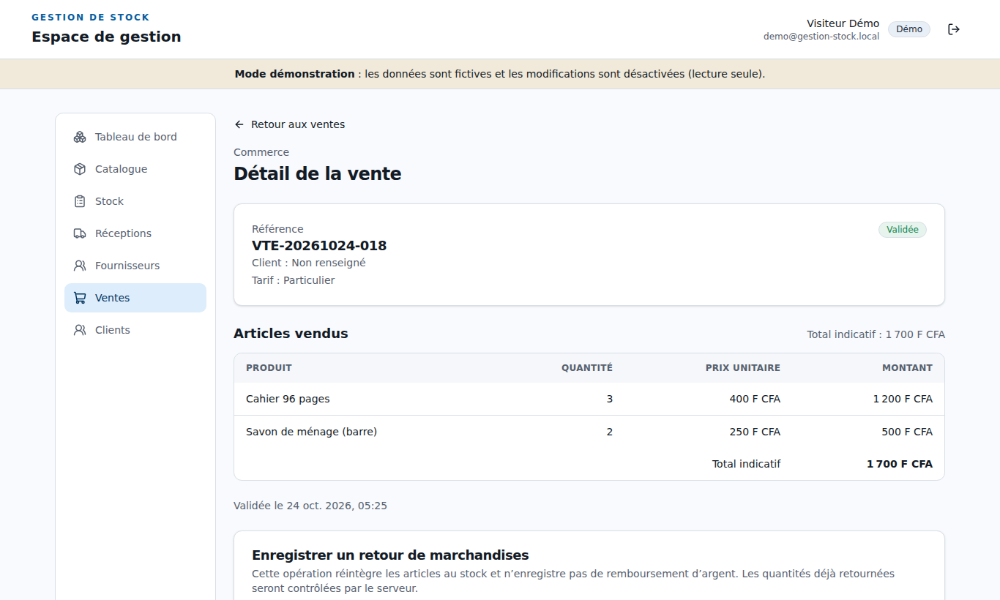
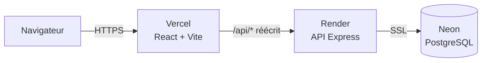

# Gestion de stock

Application web de gestion de stock et de ventes pour un petit commerce : catalogue, réceptions fournisseurs, ventes, retours clients, inventaires et suivi de chaque mouvement de stock. Les montants sont en **FCFA**.

**▶ Démo en ligne : [gestion-stock-pied-three.vercel.app](https://gestion-stock-pied-three.vercel.app)**

Sur la page de connexion, cliquez sur **« Explorer la démo »** : aucun compte n'est nécessaire. Vous accédez à une boutique générale fictive (35 produits, environ 400 ventes sur 5 semaines) en **lecture seule**.

> L'API est hébergée sur un plan gratuit qui s'endort après 15 minutes d'inactivité. Le premier chargement peut prendre **jusqu'à une minute** : le bouton apparaît dès que le serveur est réveillé.



## Aperçu

| | |
|---|---|
|  |  |
| **Catalogue** : recherche, catégories, seuils critiques | **Stock** : niveaux, alertes et historique des mouvements |
|  |  |
| **Ventes** : brouillons et ventes validées | **Détail d'une vente** : lignes, tarif client, retour de marchandises |

## Fonctionnalités

- **Catalogue** : produits, catégories, unités de mesure, plusieurs unités par produit avec facteur de conversion (bouteille, carton de 12, sac de 25 kg…).
- **Tarification** : une grille de prix par type de client (Particulier, Revendeur) et par unité de vente, en FCFA entiers.
- **Réceptions** : bon de réception en brouillon, puis validation qui entre le stock et recalcule le **coût moyen pondéré**.
- **Ventes** : brouillon, ajout d'articles au prix du catalogue, validation qui sort le stock. Le coût au moment de la vente est conservé pour calculer les marges.
- **Retours clients** : remise en stock des articles retournés, avec contrôle des quantités déjà retournées côté serveur.
- **Inventaire** : stock d'ouverture, ajustements (casse, péremption), comptages et annulation d'opérations.
- **Mouvements** : chaque entrée et sortie est tracée ; le stock affiché correspond toujours à la somme des mouvements.
- **Tableau de bord** : produits actifs, ruptures, stocks faibles et activité des 7 derniers jours.
- **Clients et fournisseurs** : fiches, et types de clients qui déterminent le tarif appliqué.
- **Authentification** : jetons JWT, rôles `ADMIN` et `DEMO`.

## Choix techniques

- **Le stock repose sur un journal de mouvements.** Chaque opération (réception, vente, retour, ajustement) écrit ses lignes et ses mouvements dans une transaction PostgreSQL, et met à jour le stock courant et le coût moyen.
- **Conversions d'unités dans la base.** Chaque ligne stocke la quantité saisie et son facteur ; la quantité en unité de base est une colonne calculée par PostgreSQL.
- **Le mode démo est appliqué côté serveur.** Le rôle `DEMO` est contenu dans le jeton, et un seul middleware refuse toute requête d'écriture (`403 DEMO_READ_ONLY`). Masquer des boutons dans l'interface ne suffirait pas.
- **Connexion en un clic sans mot de passe exposé.** Le compte visiteur a un mot de passe aléatoire que personne ne connaît. La route `POST /api/auth/demo` ne délivre jamais un jeton d'un autre rôle que `DEMO`, et elle a son propre limiteur de requêtes.
- **Pas de CORS à configurer.** Le navigateur ne parle qu'à Vercel, qui réécrit `/api/*` vers l'API.
- **Données de démonstration reproductibles.** Un script simule 35 jours d'activité avec la même logique métier que l'application (coût moyen, stock, mouvements). Il refuse de s'exécuter sur une base qui contient déjà des produits.
- **Sécurité de base** : mots de passe hachés avec bcrypt, en-têtes `helmet`, limitation des tentatives de connexion, taille des requêtes bornée, secrets uniquement dans l'environnement.

## Architecture



| Couche | Technologies |
|---|---|
| Frontend | React 19, TypeScript, Vite, React Router 7, Tailwind CSS 4, composants de style shadcn/ui, lucide-react |
| Backend | Node.js 22, Express 5, `pg`, jsonwebtoken, bcryptjs, helmet, express-rate-limit |
| Base de données | PostgreSQL 16, migrations SQL versionnées |
| Tests et qualité | Jest + Supertest, Vitest + Testing Library, ESLint, Prettier, Oxlint |
| CI/CD | GitHub Actions ; déploiement automatique sur Vercel et Render à chaque push |

## Démarrage en local

**Prérequis** : Node.js 22+ et PostgreSQL 16+.

```bash
git clone https://github.com/XAlbert07/gestion-stock.git
cd gestion-stock
```

**1. Base de données**

```bash
sudo -u postgres psql \
  -c "CREATE USER gestion_stock_user WITH PASSWORD 'change_me';" \
  -c "CREATE DATABASE gestion_stock OWNER gestion_stock_user;"
```

**2. Backend**

```bash
cd backend
npm install
cp .env.example .env     # puis renseignez DB_PASSWORD, JWT_SECRET (32 caractères minimum) et ADMIN_*
npm run db:migrate
npm run bootstrap:admin  # crée le compte administrateur
npm run dev              # API sur http://localhost:3000
```

**3. Frontend** (dans un second terminal)

```bash
cd frontend
npm install
npm run dev              # application sur http://localhost:5173
```

Le serveur de développement redirige `/api` vers `localhost:3000` : aucune configuration frontend n'est nécessaire.

**4. Mode démo en local (facultatif)**

Dans `backend/.env`, passez `DEMO_LOGIN_ENABLED=true`, puis :

```bash
npm run bootstrap:demo   # crée le compte visiteur en lecture seule
npm run db:seed:demo     # charge la boutique de démonstration (base sans produit)
```

Le bouton « Explorer la démo » apparaît sur la page de connexion. Pour repartir de zéro : `npm run db:seed:demo -- --reset --yes` (**efface** produits, ventes, clients et fournisseurs ; les comptes utilisateurs sont conservés).

## Variables d'environnement (backend)

| Variable | Rôle | Défaut / exemple |
|---|---|---|
| `PORT` | Port de l'API | `3000` |
| `DB_HOST`, `DB_PORT`, `DB_NAME`, `DB_USER`, `DB_PASSWORD` | Connexion PostgreSQL | requis |
| `DB_SSL` | `true` pour une connexion chiffrée (Neon, Supabase…) | `false` |
| `JWT_SECRET` | Secret de signature (32 caractères minimum) | requis |
| `JWT_EXPIRES_IN` | Durée de validité d'une session | `8h` |
| `TRUST_PROXY_HOPS` | Nombre de proxys devant l'API | `0` (local), `1` (Render) |
| `ADMIN_FIRST_NAME`, `ADMIN_LAST_NAME`, `ADMIN_EMAIL`, `ADMIN_PASSWORD` | Compte créé par `bootstrap:admin` (mot de passe de 12 caractères minimum) | |
| `DEMO_LOGIN_ENABLED` | Active le bouton « Explorer la démo » | `false` |
| `DEMO_USER_EMAIL` | Adresse du compte visiteur | `demo@gestion-stock.local` |
| `SEED_DEMO` | Charge la démo au démarrage si la base est vide (`start:render`) | `false` |

Côté frontend, `VITE_API_URL` est facultative : elle permet de cibler une API distante au lieu de `/api`.

## Commandes utiles

| Dossier | Commande | Effet |
|---|---|---|
| `backend` | `npm run dev` | API avec rechargement automatique |
| `backend` | `npm run check` | lint, format et tests |
| `backend` | `npm run db:migrate` | applique les migrations |
| `backend` | `npm run db:seed:demo` | charge les données de démonstration |
| `backend` | `npm run start:render` | démarrage de production (migrations, comptes, démo, API) |
| `frontend` | `npm run build` | vérification TypeScript et build de production |
| `frontend` | `npm run lint` | Oxlint |
| `frontend` | `npm test` | tests Vitest |

## Tests et intégration continue

- **Backend** : tests unitaires avec Jest et Supertest, et un test d'intégration sur un vrai PostgreSQL (`RUN_POSTGRES_INTEGRATION=1`).
- **Frontend** : tests de composants et de parcours avec Vitest et Testing Library.
- **GitHub Actions** : à chaque push, le workflow lance un PostgreSQL 16, applique les migrations, puis exécute `npm audit`, le lint, le format et les tests des deux projets, ainsi que le build du frontend.

## Déploiement

Le projet est déployé gratuitement sur trois services. Chaque `git push` sur `main` redéploie automatiquement.

**1. Base de données : Neon.** Créez un projet PostgreSQL 16, puis récupérez l'adresse de connexion (avec « Connection pooling » désactivé) pour renseigner `DB_HOST`, `DB_NAME`, `DB_USER` et `DB_PASSWORD`.

**2. API : Render.** Le fichier `render.yaml` décrit le service (Blueprint). Il exécute `npm run start:render` : migrations, création de l'administrateur (si `ADMIN_PASSWORD` est défini), du compte visiteur et des données de démonstration, puis démarrage de l'API. Les paramètres Neon se saisissent dans l'onglet *Environment* (`DB_SSL=true`, `DB_PORT=5432`).

**3. Frontend : Vercel.** Définissez *Root Directory* sur `frontend`. Le fichier `frontend/vercel.json` redirige `/api/*` vers l'URL Render et gère le routage de l'application monopage.

## Structure du projet

```
gestion-stock/
├── backend/
│   ├── src/
│   │   ├── modules/       # auth, catalogue, produits, inventaire, réceptions,
│   │   │                  # ventes, clients, fournisseurs
│   │   ├── middlewares/   # authentification, limiteurs, erreurs
│   │   └── config/        # environnement, base de données, mode démo
│   ├── migrations/        # schéma PostgreSQL versionné
│   ├── seeds/             # données de démonstration
│   ├── scripts/           # migrate, bootstrap admin / démo, seed
│   └── tests/
├── frontend/
│   └── src/
│       ├── features/      # catalogue, stock, réceptions, ventes, fournisseurs
│       ├── pages/         # connexion, tableau de bord
│       ├── auth/          # contexte d'authentification
│       └── components/    # coque de l'application, composants d'interface
├── docs/screenshots/      # captures utilisées dans ce README
└── render.yaml            # déploiement de l'API
```

Le détail des routes de l'API se trouve dans [`backend/README.md`](backend/README.md).

## Limites connues

- **Démarrage à froid.** Sur les plans gratuits, l'API met environ 50 secondes à se réveiller, et la base Neon environ 1 à 2 secondes après une pause.
- **Un seul rôle d'écriture.** `ADMIN` a tous les droits et `DEMO` est en lecture seule ; il n'y a pas encore de permissions plus fines.
- **Pas de gestion des utilisateurs dans l'interface.** Les comptes se créent par script.
- **Limite de connexions partagée.** Derrière le proxy Vercel, les visiteurs partagent la même adresse IP pour la limitation des tentatives de connexion.
- **Boutons d'écriture visibles en démo.** Ils renvoient un message clair au lieu d'être masqués.

## Auteur

Projet personnel réalisé par [@XAlbert07](https://github.com/XAlbert07).
